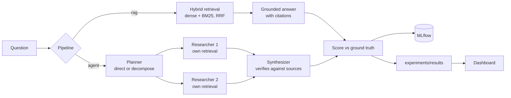

# Ground Truth

**A RAG and multi-agent system that measures itself.**

Most RAG demos show that a chatbot answers a few questions. Ground Truth asks the questions that matter for a
production system: how often is it right, does it cite real sources, does it say "I don't know" when it should, does
it pick the current policy over an outdated one, and what does each improvement cost in latency and tokens?
Every experiment is scored against the same set of ground-truth questions, and every answer can be inspected.

**Live dashboard:** https://clarkngo.github.io/ground-truth/ (recorded results from real runs; see [Demo mode](#demo-mode))

> A portfolio project inspired by my work at City University of Seattle, where I built RAG chat systems on
> self-hosted models and a supervisor-based multi-agent framework. All code here is original. The corpus is a
> fictional university written for this project.

## Results so far

Scored against all 58 ground-truth questions, run locally on an Apple M2 (16 GB) with `qwen2.5:7b`.

| Experiment | Accuracy | Multi-hop | Numeric | Latest version | Correct refusals | False refusals | Valid citations | p50 latency |
|---|---|---|---|---|---|---|---|---|
| **baseline** (heading chunks, hybrid retrieval, k=5) | **93.1%** | 81.8% | 75.0% | 100% | 100% | 0% | 100% | 9.7 s |
| dense-only retrieval | 89.7% | 54.5% | 87.5% | 100% | 100% | 0% | 100% | 9.5 s |

What they show:

- **Retrieval metrics alone hid a real loss.** Dense-only retrieval found the gold documents almost as often as
  hybrid (97.9% vs 99.0% recall), yet multi-hop accuracy fell from 82% to 55%. The answer often needs the *second*
  document of a chain, and only end-to-end scoring caught that.
- **The baseline's remaining errors are arithmetic and reasoning, not retrieval.** It computed 9 × $665 as $6,005,
  charged a per-quarter fee per credit, and named the wrong shared prerequisite. That led to the calculator experiment.
- **A prompt-only tool convention didn't work; native function calling did.** Asking the 7B model to write arithmetic
  as `{{9 * 665}}` was ignored in spot checks. Giving it a real `calculate` tool through Ollama's function calling
  produced $5,985 (spot check: about 2× the tokens; the full run will measure it). Calculator use is measured per run, so a gain can't be wrongly credited to the tool.
- **I found two bugs in my own scorer by reading answers:** citations written as `[a, b]` weren't parsed, and an answer
  saying a 3.2 GPA "is high enough" for a 3.5 honor passed because both numbers appeared. Both are fixed and covered by
  tests, and `gt rescore` re-scores saved answers without re-running models.

Runs comparing other models (llama3.1:8b, mistral:7b, qwen3.5:4b), the supervisor agent and the calculator tool
are in progress; the [dashboard](https://clarkngo.github.io/ground-truth/) shows each one as it lands.


## What's being tested

The corpus is 26 documents for **Larkspur Institute of Technology**, a fictional university: policies, tuition, course
catalogs, programs and services ([`corpus/`](corpus)). It has deliberate traps:

- **Two versions** of the AI-use policy and of tuition and fees. The newer one declares `supersedes:`.
- **Prerequisite chains** that span documents (AI 330 → AI 210 → CS 160 and MATH 201 → …).
- **Facts that must be combined**: a price from one document, a refund rule from another, a quarter start date from a third.
- **Questions the corpus can't answer**, where the right response is to refuse.

The 58 ground-truth questions ([`evals/questions.yaml`](evals/questions.yaml)) fall into five types:

| Type | Count | What a correct answer needs |
|---|---|---|
| Factual | 21 | One fact from one document |
| Numeric | 8 | Arithmetic over facts (e.g. 15 credits × $435) |
| Multi-hop | 11 | Facts from two or more documents, or a chain of them |
| Latest version | 8 | The current policy when an older one also exists |
| Unanswerable | 10 | "I don't know based on the provided sources." |

**Scoring is deterministic: there's no LLM judge.** Each answerable question lists the facts a correct answer must
contain, as groups of acceptable alternatives (`["6,525", "6525"]`). An answer is correct when every group matches
and it didn't refuse. Unanswerable questions are correct only when the system refuses. Every pass or fail can be
traced to a pattern, so the score can't drift with a judge model's mood.

| Metric | Meaning |
|---|---|
| Accuracy | Correct answers across all 58 questions |
| Correct refusals | Unanswerable questions where the system said it didn't know |
| False refusals | Answerable questions where it wrongly said it didn't know |
| Valid citations | Answers whose every `[doc-id]` citation was actually retrieved, which catches invented sources |
| Retrieval recall / MRR | Whether the gold source documents came back, and how high |
| Latency, tokens | Cost of each configuration on a laptop (Apple M2, 16 GB) |

## How it works



- **Chunking:** by `##` heading, with a document-and-section header on every chunk so "Prerequisite: AI 210" stays
  tied to its course. Fixed 500-character windows are the baseline to beat.
- **Retrieval:** dense (`nomic-embed-text` via Ollama, with its `search_query:` / `search_document:` prefixes, stored
  in ChromaDB), BM25 (a small dependency-free implementation), and hybrid via reciprocal rank fusion.
- **Generation:** local models through Ollama at temperature 0 with a fixed seed, so reruns are comparable. The
  prompt includes each source's effective date and what it supersedes, requires a citation after every claim, and
  defines the exact refusal sentence.
- **Supervisor agent:** a planner decides whether a question needs decomposing. If so, researchers answer each
  sub-question from their own retrieval, sources are pooled round-robin (so no sub-question loses its evidence to a
  cap), and a synthesizer writes the final answer, verifying the findings against the sources.
- **Tracking:** every run writes a JSON result (committed, so the dashboard can show it) and an MLflow run
  (`mlflow ui --backend-store-uri sqlite:///mlflow.db`).

## Run it

Requires [uv](https://docs.astral.sh/uv/) and [Ollama](https://ollama.com).

```bash
ollama pull nomic-embed-text && ollama pull qwen2.5:7b
uv sync
uv run gt ask "How much tuition is refunded if I withdraw from a 5-credit course in week 3 of Fall 2025?"
uv run gt eval baseline agent        # or: uv run gt eval all
uv run gt report                     # leaderboard in the terminal
uv run gt export && npm --prefix web install && npm --prefix web run dev   # dashboard at localhost:5173
uv run gt serve                      # API for the dashboard's Ask page
```

Experiments are defined in [`experiments/configs.yaml`](experiments/configs.yaml): chunking, retriever, k, model and
pipeline. Add one and run `uv run gt eval <name>`.

## Tests and CI

- `uv run pytest`: metrics, chunking, BM25, agent planning and data consistency (every gold document exists,
  superseding documents are newer). No model server is needed.
- **Retrieval regression gate:** CI runs deterministic BM25 retrieval over all ground-truth questions and fails the
  build if recall drops below 95% or MRR below 0.90 (`uv run gt gate`). A corpus, chunking or question change that
  hides the right documents can't merge silently.
- The dashboard builds in CI, and the Pages workflow publishes it with the committed results.

## Demo mode

GitHub Pages can't run Ollama. The dashboard reads experiment results from static JSON (`uv run gt export`), so the
published site shows the real recorded answers, citations, sources and agent steps. Only the **Ask** page needs the
local server.

## Design decisions

- **Deterministic scoring over an LLM judge.** A judge model adds cost, variance and its own errors. Expected-fact
  patterns are stricter to write, but every verdict is explainable, and the tests check the scorer itself.
- **Refusal is a first-class metric.** A system that answers everything looks accurate on easy questions and fails
  dangerously on the rest. Correct refusals and false refusals are tracked separately, because improving one usually
  costs the other.
- **Version awareness in the prompt, not the index.** Superseded documents stay retrievable, because "what was the
  policy in 2024?" is a valid question. The model sees effective dates and `supersedes:` and is told to prefer the
  newer one unless asked about an earlier year.
- **Agents are measured, not assumed.** The supervisor runs on the same questions as plain RAG, so its accuracy gain
  (or loss) is weighed against its extra latency and tokens, per question type.
- **Known limits.** The corpus is small and its topics are distinct, so retrieval is close to saturated and the
  differences show up in generation. A larger corpus with overlapping documents would stress retrieval more.
  Expected-fact patterns can't judge style or completeness beyond the listed facts.

## Project layout

```
corpus/                 Fictional university documents (Markdown with front matter)
evals/questions.yaml    Ground-truth questions, gold documents and expected facts
experiments/            Experiment configs and recorded results
src/groundtruth/        Chunking, retrieval, RAG, supervisor agent, metrics, evaluation, API, CLI
tests/                  Unit tests (no model server needed)
web/                    React + Ant Design dashboard
```
